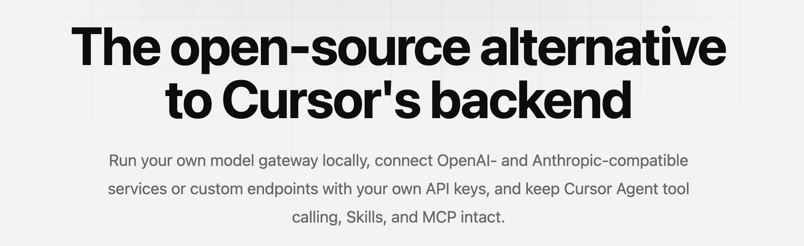
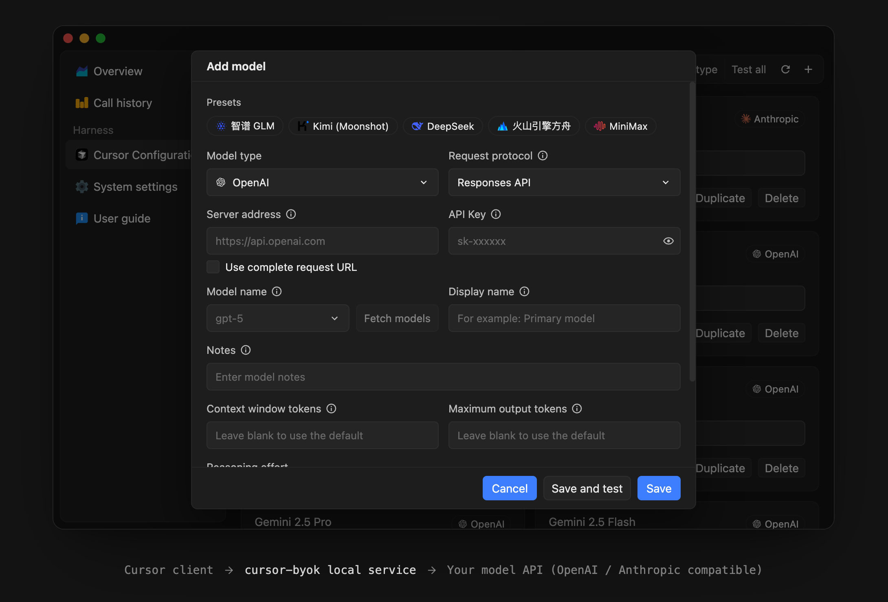

<div align="center">

# cursor-byok

在 Cursor 中使用你自己的模型 API。

[下载](https://github.com/leehainuo/cursor-byok/releases) · [提交问题](https://github.com/leehainuo/cursor-byok/issues) · [English](./README.md)

[](https://github.com/leehainuo/cursor-byok/releases)
[](./LICENSE)


</div>




## 项目简介

cursor-byok 是一个开源的本地 Cursor 模型网关。连接你自己的 OpenAI、Anthropic 兼容 API，继续使用工具调用、Skills、MCP 和多轮对话等 Agent 能力。

## 主要功能

- **自定义模型**：配置 API 地址、密钥、模型 ID 和请求参数。
- **模型管理**：添加、编辑、排序模型配置，并批量测试连接。
- **连接性能测试**：测量响应延迟和生成速度。
- **会话指标**：查看 Token 用量、缓存命中和对话活动。
- **跨平台运行**：支持 macOS、Windows 和 Linux。



## 工作原理

```text
Cursor 客户端
    │
    │ Agent 请求与工具结果
    ▼
cursor-byok 本地服务
    │
    │ OpenAI / Anthropic 兼容请求
    ▼
你配置的模型 API
```

cursor-byok 在本机处理协议适配、模型请求转发、工具调用协调和会话状态。API Key 与应用设置保存在本地；模型请求仍会发送到你配置的服务商。

## 项目初衷

许多 Agent 产品将工具能力与固定的模型、订阅和计费方案绑定，用户只能使用平台提供的模型通道。

cursor-byok 希望将模型选择权交还给用户。开发者可以充分利用已有的 API 和额度，选择适合自己的模型与服务商，并在需要时自行部署相关服务。

## 致谢

本项目基于 [leookun/cursor-byok](https://github.com/leookun/cursor-byok)，由 [leehainuo](https://github.com/leehainuo) 独立维护。感谢原作者及所有贡献者。

项目采用 [MIT License](./LICENSE)。原作者版权声明和完整许可文本见[第三方许可](./THIRD-PARTY-LICENSES.md)。
